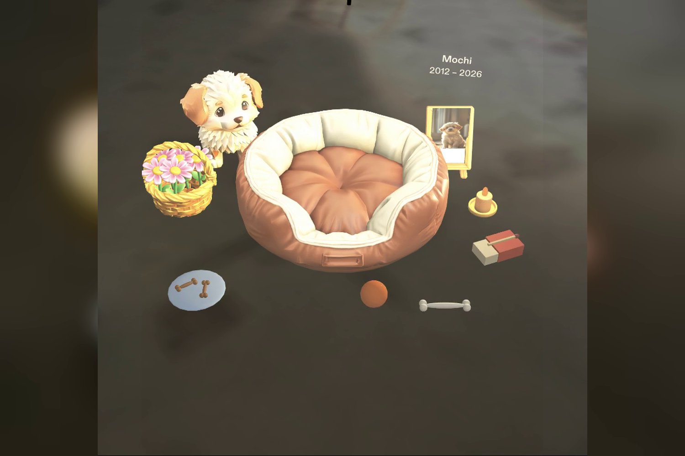

# Their Spot

A pet memorial Lens for SPECS. The user lights a candle in the spot their pet loved, and the pet appears there at real size to play with them again.

## Overview

Their Spot is built for people who have lost a pet and want a quiet way to remember them in the place they lived. The memorial is placed on the user's own floor. Lighting a candle brings the pet in, and the experience moves from remembrance to play and back to rest, in one continuous flow.

The project includes a sample pet and photo to demonstrate the experience.

## Features

- **Placement.** A ring on the floor marks where the memorial will go. Pinching it places a bed, a framed photo with a name plaque, a candle, a matchbox, a flower basket and a treat dish.
- **Candle.** The user picks up the match, rubs it along the box to strike it, and brings the flame to the wick. The candle lights and the pet appears beside the photo.
- **Flowers.** Flowers can be taken from the basket and dropped. They land on whatever is below, including the pet's back.
- **Play.** The ball and the bone can be thrown across the floor. The pet finds a path around the furniture, fetches the toy and brings it back. Holding a treat near the pet makes it sit up and beg.
- **Rest.** A "Rest now" button sends the pet to its bed, where it curls up while the candle keeps burning.
- **Photo.** Pinching the photo brings it up close, next to a card with the pet's name and a short note.
- **Physics and sound.** Objects on the floor are solid and settle naturally. If a toy lands out of view, the pet barks from its position so the user can turn toward it.

## Why glasses

On a phone, a memorial is a picture behind glass. On SPECS, it sits on the real spot in the user's home, at real size, and the pet moves across the real floor. The user's hands stay free to light the candle, place flowers and throw the ball, and their attention stays on the spot itself.

## Built with

- Lens Studio 5.23.2 (SPECS Base Template)
- CLAD and the Lens Studio MCP
- Spectacles Interaction Kit (pinch, grab and throw)
- Spectacles UI Kit (buttons)
- TypeScript

The Lens was planned with the Devpost Learn skill pack. The approved design brief is in [`devpost/design-brief.md`](devpost/design-brief.md).

## Project structure

| Path | Contents |
|---|---|
| `memorial.esproj` | Lens Studio project file |
| `Assets/Scene.scene` | Main scene |
| `Assets/Scripts/TheirSpotMain.ts` | Memorial flow: placement, candle, flowers, treats, rest and photo |
| `Assets/Scripts/TheirSpotPet.ts` | Pet behaviour and grid pathfinding around furniture |
| `Assets/Scripts/TheirSpotBall.ts` | Throwable toys |
| `Assets/Scripts/TheirSpotSolids.ts` | Solid floor objects and landing surfaces |
| `Assets/Scripts/TheirSpotUI.ts` | Hints and the "Rest now" button |
| `Assets/Scripts/TheirSpotMeshes.ts` | Procedural meshes for the placement ring and photo |
| `Assets/GeneratedMeshes/` | 3D models generated from text prompts |
| `Assets/GeneratedSFX/`, `Assets/Audio/` | Music and sound effects |
| `devpost/design-brief.md` | Design brief |

## Running the Lens

1. Install Lens Studio 5.23.2 or later.
2. Open `memorial.esproj`.
3. In the Preview panel, use Interactive Preview. A mouse click acts as a pinch. Use WASD to move, Q and E to move down and up, and right-drag to look around.
4. Pinch the ring on the floor to place the memorial, then follow the hints.

## Preview notes

The Lens Studio preview room stands in for the user's floor, and the mouse stands in for a pinching hand. The flow and interactions run fully in the preview. How the experience feels in a real room can only be confirmed on SPECS hardware.
